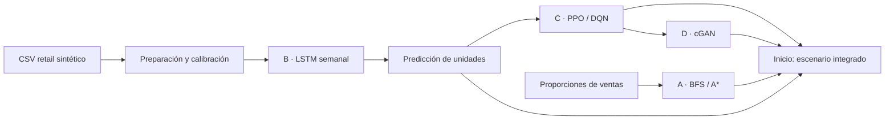
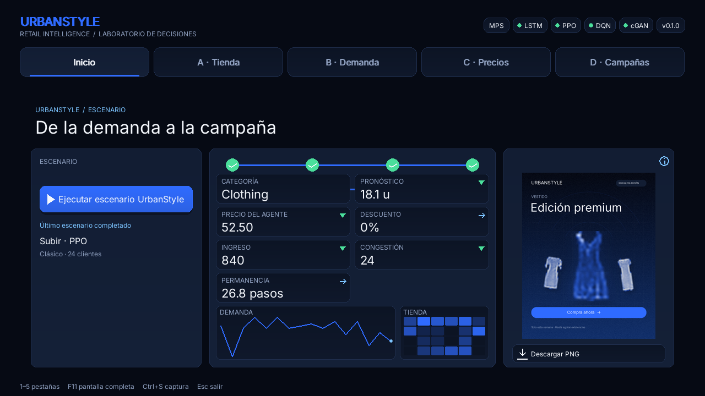
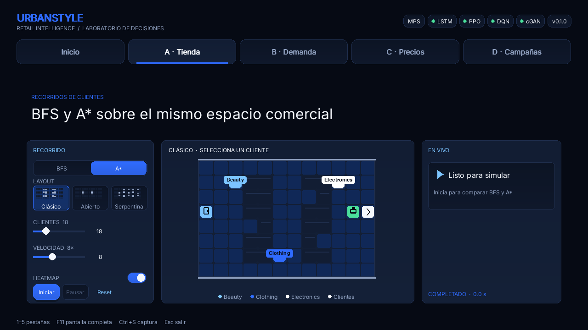
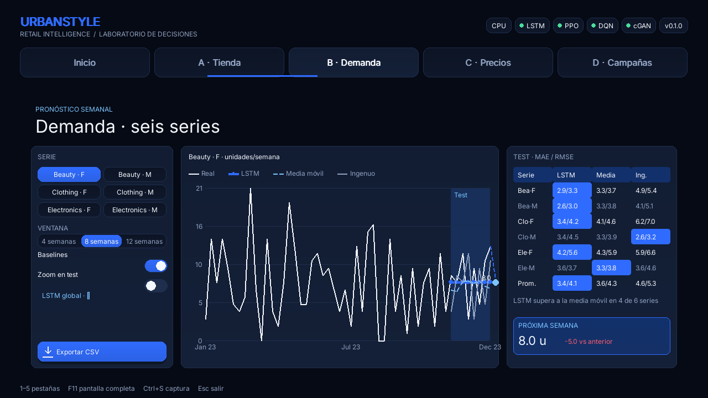
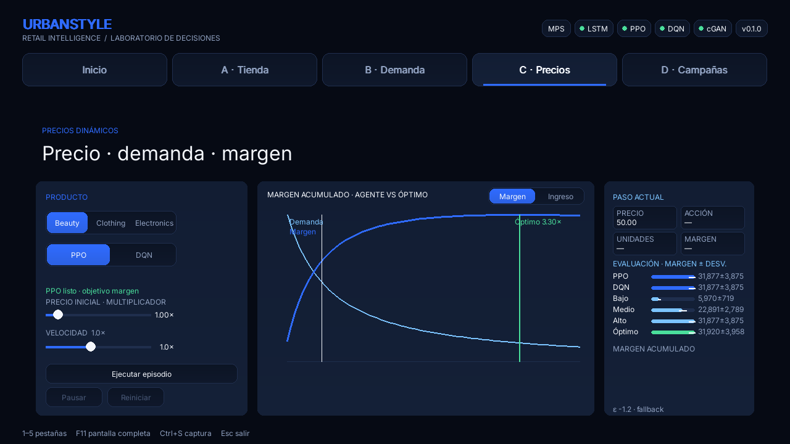
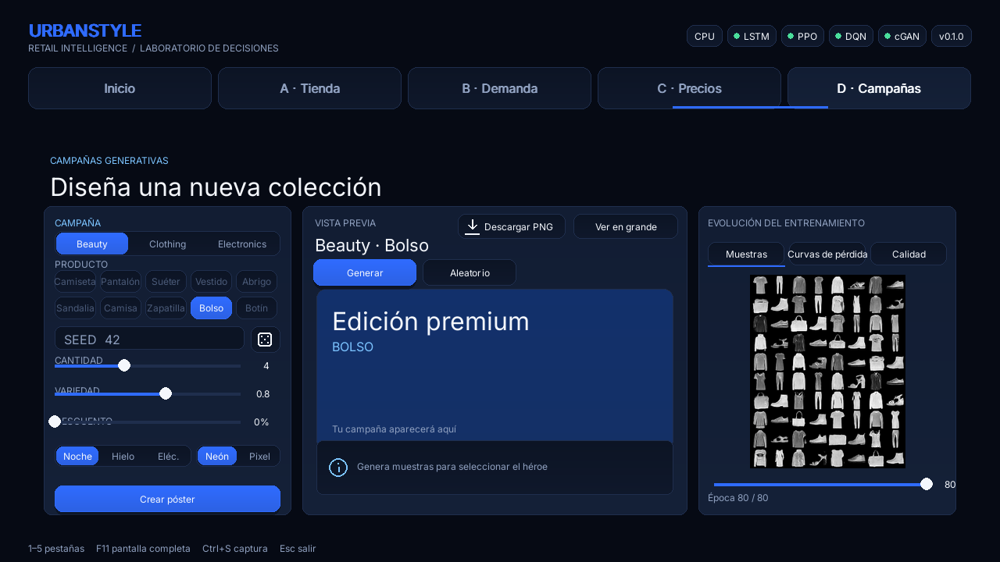

# UrbanStyle

[](https://www.python.org/)
[](https://pytorch.org/)
[](https://gymnasium.farama.org/)
[](https://pytest.org/)

UrbanStyle es una aplicación de escritorio en Pygame para explorar cuatro usos de IA en una tienda de moda ficticia: distribución y recorridos, pronóstico semanal, precios dinámicos y campañas visuales.

## Índice

- [Contexto y arquitectura](#contexto-y-arquitectura)
- [Instalación](#instalación)
- [Ejecución](#ejecución)
- [Task A: recorridos y layouts](#task-a-recorridos-y-layouts)
- [Task B: pronóstico de demanda](#task-b-pronóstico-de-demanda)
- [Task C: precios dinámicos con RL](#task-c-precios-dinámicos-con-rl)
- [Task D: imágenes promocionales](#task-d-imágenes-promocionales)
- [Escenario integrado](#integración-escenario-urbanstyle)
- [Estructura del proyecto](#estructura-del-proyecto)
- [Pruebas y calidad](#pruebas-y-calidad)
- [Reproducibilidad, límites y licencias](#reproducibilidad-límites-y-licencias)
- [Documentos de entrega](#documentos-de-entrega)

## Contexto y arquitectura

El CSV de Kaggle es sintético: sirve para explorar el flujo y probar algoritmos, no para inferir decisiones de un retailer real. Las seis series son Producto×Género (3×2). Se conserva esa dimensión para inspeccionar diferencias y pasar pronósticos al módulo de precios.



Todos los entrenamientos se ejecutan mediante scripts independientes. Pygame carga checkpoints existentes y presenta avisos accionables si faltan datos o modelos.

Evidencias generadas de la corrida actual: [curva LSTM](docs/forecast_training_curve.png), [pricing RL](docs/pricing_evaluation.png), [layouts](docs/layout_experiment.png), [pérdidas DCGAN](docs/dcgan_losses.png), [muestras DCGAN](docs/dcgan_epoch_005.png), [pérdidas cGAN](docs/cgan_losses.png), [evolución cGAN · época 5](docs/cgan_epoch_005.png), [época 60](docs/cgan_epoch_060.png), [época 80](docs/cgan_epoch_080.png) y [mejor EMA](docs/cgan_best_ema.png). El CSV de layouts copiado a docs es el smoke test de una repetición; no debe leerse como comparación estadística.

Capturas de la aplicación:

| Inicio | Task A · Recorridos | Task B · Pronóstico |
| --- | --- | --- |
|  |  |  |

| Task C · Pricing | Task D · Campañas | |
| --- | --- | --- |
|  |  | |

## Instalación

- Python 3.10 o 3.11.
- El archivo original `retail_sales_dataset.csv` en `data/raw/`.
- Windows: los comandos usan `py -3.11`; también sirven `python` o `python3` si apuntan a Python 3.10/3.11.

## Instalación y preparación

```powershell
py -3.11 -m venv .venv
.\.venv\Scripts\Activate.ps1
python -m pip install --upgrade pip
python -m pip install -r requirements.txt
python scripts/prepare_data.py
```

Coloca el CSV de Kaggle “Retail Sales Dataset” (Mohammad Talib) en `data/raw/retail_sales_dataset.csv`. La preparación crea las seis series semanales en `data/processed/weekly_sales.csv` y estadísticas/calibraciones en `data/processed/calibration.json`. Si falta el archivo, el script indica la ruta exacta y no inventa datos.

La primera instalación descarga Fashion-MNIST cuando se entrena Task D. En el CPU usado para validar, las corridas configuradas tardaron aproximadamente 5.5 s (LSTM), 22 s (PPO+DQN) y 40 s (DCGAN+cGAN). Son referencias locales; el tiempo depende del hardware, la configuración de Torch y el estado de la caché de datos.

## Aplicación

```powershell
python -m app.main
```

La ventana contiene Inicio y las pestañas A, B, C y D. Inicio ejecuta el escenario integrado; A permite elegir algoritmo/layout y animar tráfico; B compara pronósticos; C ejecuta episodios con modelos PPO/DQN; D genera imágenes y pósteres desde un cGAN.

La interfaz usa una paleta azul noche con tokens centralizados en `config.yaml`: fondo `#060A14`, panel `#0C1424`, elevado `#121D33`, borde `#1F2E4D`, primario `#2F6BFF`, cielo `#7CC4FF` y texto `#F4F7FC`. Los layouts ponderados se adaptan al tamaño de ventana. Inter se incluye en `assets/fonts/Inter.ttf` bajo SIL Open Font License, distribuida en `assets/fonts/OFL-Inter.txt`; si falta la fuente, se usa Segoe UI.

La pestaña D permite elegir categoría y clase con chips, editar la seed, cantidad, truncation/variedad y descuento, y seleccionar plantilla (Medianoche, Hielo o Eléctrico) y estilo (Neón o Pixel). La vista previa muestra el póster 4:5 con selección de héroe; la galería de entrenamiento permite revisar muestras, pérdidas y accuracy condicional por época. Los pósteres de 1080×1350 se guardan en `outputs/posters/` y usan luminancia con máscara alfa de gamma 0.8 y umbral suave, gradiente de color, sombra, resplandor y reflejo. La accuracy condicional describe reconocimiento de clase y no mide por sí sola calidad perceptual.

El mapeo categoría→clases se configura en `config.yaml`: Clothing se asocia a prendas (Camiseta, Suéter, Vestido, Abrigo y Camisa); Beauty se representa con Bolso y Electronics con Zapatilla/Botín. Fashion-MNIST no contiene cosméticos ni productos electrónicos, por lo que Beauty→accesorios y Electronics→calzado urbano son sustitutos visuales explícitos, no equivalencias semánticas del dataset. Para el póster se generan 64 candidatas y el clasificador existente ordena las tres mejores para clase; una imagen generada por el usuario puede reemplazar la primera como héroe. El copy publicitario se deriva de la decisión determinista del agente configurado: mantener produce “Nueva colección”, subir “Edición premium” y bajar calcula el descuento respecto al precio de referencia; descuentos menores al 10 % se muestran como “Precio especial”. El slider se inicializa con esa recomendación y permite un override manual explícito. Si falta modelo o calibración, se usa el slider como origen del descuento.

Validación de esta fase: `python -m pytest tests/test_gan_generation.py tests/test_layout_no_overflow.py -q`. Las pruebas verifican tamaño exacto y formato PNG en las tres plantillas, reglas del copy según acción/precio, transparencia de fondo negro y bounds de los controles en 1280×720, 1366×768 y 1920×1080. La captura de la pestaña D está en [docs/captura_task_d.png](docs/captura_task_d.png).

Inicio presenta el botón principal, stepper Demanda→Precio→Tienda→Campaña, siete KPI, sparkline de demanda, mini heatmap agregado y el póster del escenario con descarga. El escenario sigue ejecutándose en un worker; el pipeline emite progreso por etapa y serializa el tráfico para los siguientes inicios. Los resúmenes previos que no tienen heatmap conservan un hotspot de fallback basado en la celda de congestión. La captura de Inicio está en [docs/captura_inicio.png](docs/captura_inicio.png).

Fase 4 se validó con `python -m pytest tests/test_integration_pipeline.py tests/test_layout_no_overflow.py -q` y con la suite completa (`python -m pytest -q`). Para comprobar visualmente la aplicación: `python -m app.main`. También se corrigieron dos cierres de Pygame: el heatmap de A mezcla ahora exclusivamente canales RGB y el halo de slider construye explícitamente un color RGBA válido.

Los atajos son `1`–`5` para pestañas, `Espacio` para pausar A/C, `R` para reiniciar A/C, `F11` pantalla completa, `Ctrl+S` captura y `F1` o `H` para ayuda. `Esc` cierra la ayuda o la app.

## Task A: recorridos y layouts

Los layouts clásico, abierto y serpentina se construyen sobre una grilla ortogonal configurable (por defecto 12×8, mínimo 8×6). La vista representa suelo, perímetro, estanterías y pasillos; las secciones muestran sus nombres completos, y Entrada/Caja usan iconos distintos. Tres miniaturas permiten elegir el layout. Los clientes se dibujan con halo y estela; al hacer clic en uno se resalta su ruta completa. El switch de heatmap y el ranking de las cinco zonas más transitadas permiten revisar la congestión. Las visitas a secciones se ponderan por la proporción de ventas de `calibration.json`, o se calculan desde el CSV original si aún no se ha ejecutado la preparación. No se crean proporciones sintéticas: sin CSV/calibración, el control de inicio se deshabilita y se muestra el motivo.

BFS explora por niveles y A* usa distancia Manhattan. Ambos registran nodos expandidos, longitud del tramo y tiempo. La comparación de la pestaña usa la misma semilla, número de clientes y layout. Cada cliente visita de una a tres categorías distintas, pasa por caja y sale; el mapa agrega tráfico con un gradiente azul profundo a cielo.

Para ejecutar el experimento reproducible (20 simulaciones por cada layout y algoritmo, 24 clientes por simulación):

```powershell
python scripts/run_layout_experiment.py
```

Se pueden ajustar las repeticiones y clientes con `--runs N --customers N`; `--seed N` cambia la semilla inicial. Los resultados se guardan en `outputs/layout_experiment.csv` y `outputs/layout_experiment.png`. Incluyen congestión máxima, camino medio, permanencia media, tiempo de búsqueda y nodos explorados. Para una prueba rápida: `python scripts/run_layout_experiment.py --runs 1 --customers 6`.

La corrida actual usa las 20 repeticiones configuradas y 24 clientes por corrida. La longitud media de tramo es común a BFS/A* (7.08, 5.88 y 6.68 celdas); A* expandió menos nodos y tuvo menor tiempo medio de búsqueda. Congestión máxima media:

| Layout | BFS | A* | Permanencia media |
| --- | ---: | ---: | ---: |
| Clásico | 35.65 | 28.85 | 28.37 |
| Abierto | 35.60 | 35.60 | 23.47 |
| Serpentina | 26.85 | 32.05 | 26.41 |

La congestión depende de la ruta y la seed; se informa como resultado de estas simulaciones, no como propiedad general del layout.

La pestaña A ahora presenta el suelo con perímetro y estantes en bandas, pasillos visibles, secciones con nombre completo y símbolos distintos para entrada/caja. Las tres miniaturas seleccionan layout; el toggle controla el heatmap. Los clientes tienen halo y estela, y un clic resalta la ruta completa. El panel en vivo compara BFS/A* en tarjetas con barras de nodos/tiempo y un top 5 de zonas calientes. La captura está en [docs/captura_task_a.png](docs/captura_task_a.png).

Pruebas de Task A y bounds: `python -m pytest tests/test_pathfinding.py tests/test_layout_no_overflow.py -q`. En esta entrega pasan 44 tests en total, `compileall` y Ruff.

## Task B: pronóstico de demanda

Se entrena un único LSTM global con embedding de serie (categoría×género) para pronosticar **unidades vendidas por semana**, no importe monetario. El preprocesamiento excluye periodos `W-SUN` de borde cuando el rango temporal no cubre el lunes y domingo completos. Para el CSV actual se retiran el 1 de enero de 2023 y el periodo terminado el 7 de enero de 2024, que solo contiene el 1 de enero; quedan **52 semanas completas** desde el 8 de enero hasta el 31 de diciembre de 2023. La decisión usa cobertura calendario, no número de días con ventas, por lo que una fecha completa sin transacciones no se confunde con semana parcial. Los datos originales siguen usándose para calibración general de categorías/precios.

El LSTM comparte señal entre las seis series categoría×género y Task C consume sus unidades como demanda. El split es cronológico 70/15/15; la media y desviación por serie se ajustan solo con train. Early stopping selecciona el checkpoint por MSE de validación.

Entrenamiento y evaluación:

```powershell
python scripts/train_lstm.py
python scripts/train_lstm.py --epochs 3
python scripts/evaluate_lstm.py
```

`python scripts/evaluate_lstm.py` reevalúa el checkpoint existente sin entrenar. `python scripts/evaluate_all.py` vuelve a generar las métricas test de B y las métricas de C; no reentrena ninguno de los modelos.

En el CPU usado para validar, la corrida LSTM configurada tardó aproximadamente 5.5 segundos y seleccionó 29 épocas por early stopping. El tiempo depende del hardware y de los threads disponibles.

```powershell
python scripts/train_lstm.py
python scripts/train_rl.py
python scripts/evaluate_all.py
```

El entrenamiento guarda `models/lstm.pt`, MAE/RMSE por serie y contexto en `outputs/forecast_metrics.csv`, valores reales/predichos del test en `outputs/forecast_test_predictions.csv`, pronóstico de la semana siguiente en `outputs/predictions.csv`, curva en `outputs/forecast_training_curve.png` y resumen en JSON. La pestaña B solo carga estos artefactos: no entrena en vivo. Permite cambiar serie, elegir contexto 4/8/12 semanas ya precomputado, ocultar/mostrar baselines y exportar el pronóstico.

Resultados del test, corrida actual con semilla 42 y contexto de 8 semanas:

| Serie | MAE LSTM | RMSE LSTM | MAE media móvil | MAE ingenuo |
| --- | ---: | ---: | ---: | ---: |
| Beauty · Female | 3.37 | 4.11 | 4.06 | 5.78 |
| Beauty · Male | 2.84 | 3.20 | 3.22 | 4.00 |
| Clothing · Female | 4.08 | 5.06 | 4.47 | 6.44 |
| Clothing · Male | 4.17 | 5.41 | 3.42 | 2.44 |
| Electronics · Female | 4.59 | 5.83 | 5.31 | 6.44 |
| Electronics · Male | 3.84 | 4.09 | 3.69 | 3.56 |

Después de excluir semanas parciales y reentrenar con semilla 42, el split quedó en 36 semanas train, 8 validación y 8 test; el mejor checkpoint se obtuvo tras 26 épocas. Para contexto 8, el MAE/RMSE medio fue **3.352/4.061** para LSTM, **3.604/4.285** para media móvil y **4.562/5.320** para ingenuo. El LSTM supera a la media móvil en **4 de 6 series**; no gana en todas, por ejemplo Clothing · Male favorece al baseline ingenuo. Ocho semanas de test por serie siguen siendo una muestra pequeña y no garantizan rendimiento futuro.

La pestaña B ofrece seis chips de serie, ventanas precalculadas 4/8/12, toggle de baselines y zoom en test. El gráfico muestra el test sombreado, series con estilos diferenciados, crosshair/tooltip y el valor LSTM de la semana siguiente; la tabla presenta MAE/RMSE, mejor valor por serie y promedio. La próxima semana incluye delta frente al último valor observado. Captura: [docs/captura_task_b.png](docs/captura_task_b.png).

Pruebas de Task B: `python -m pytest tests/test_forecasting.py -q`.

## Task C: precios dinámicos con RL

El entorno `DynamicPricingEnv` usa Gymnasium y es compatible con Stable-Baselines3 2.x. La observación normalizada representa precio relativo acotado, segmento, demanda pronosticada y las últimas ventas. Los tres índices de segmento usan multiplicadores de demanda configurables (`0.92`, `1.0`, `1.08`); el CSV no contiene etiquetas de edad/género enlazadas a cada pronóstico, así que son escenarios de sensibilidad, no segmentos aprendidos. Las acciones discretas bajan, mantienen o suben el precio en pasos configurables. El precio nunca sale del rango de referencia configurado.

La demanda esperada sigue `unidades_base × (precio/precio_referencia)^elasticidad`, con estacionalidad sinusoidal pequeña y ruido gaussiano truncado al calcular unidades. Si existe `outputs/predictions.csv`, Task C suma el pronóstico LSTM de los dos géneros y lo usa como demanda base; en su ausencia se usa la media semanal histórica. El dataset disponible no permite estimar una elasticidad negativa significativa en todas las categorías, por lo que se conserva el fallback configurable `-1.2` y se identifica como supuesto en `calibration.json` y en los reportes. No se simulan inventario ni ventas perdidas. El agente maximiza ahora el margen bruto por paso: `(precio - coste_unitario) × unidades_vendidas`; el ingreso se conserva como métrica secundaria. El coste unitario por defecto es el 55 % del precio de referencia, el rango de precio es 0.6×–4.0× y el episodio dura 64 pasos. Para elasticidad constante ε < -1, el óptimo continuo de margen es `p*/p_ref = (ε/(ε+1)) × coste_unitario/p_ref`; con ε = -1.2 y coste 0.55, el óptimo teórico es 3.30×. Es una referencia del modelo isoelástico, no una recomendación comercial inferida del CSV.

Entrena los dos agentes fuera de la aplicación; la UI únicamente carga modelos existentes:

```powershell
python scripts/train_rl.py
python scripts/train_rl.py --algorithm PPO --timesteps 12000
python scripts/train_rl.py --algorithm DQN --timesteps 12000
```

Modelos en `models/ppo.zip` y `models/dqn.zip`; curvas y resúmenes de entrenamiento en `outputs/`. El comando usa 12 000 pasos por agente; en el CPU de validación, PPO+DQN tardaron unos 22 segundos en total. Son modelos pequeños en un entorno simplificado y no se afirma convergencia ni validez comercial.

Evalúa con al menos 100 episodios compartidos entre agentes y políticas estáticas:

```powershell
python scripts/evaluate_rl.py --episodes 100
```

La comparativa incluye precio bajo, medio, alto, el óptimo isoelástico teórico acotado y los agentes disponibles. Se guardan media y desviación estándar de margen e ingreso, además de los resultados por episodio, en `outputs/pricing_evaluation.csv` y `.json`; `outputs/pricing_evaluation.png` grafica el margen con barras de error. Con el CSV actual, elasticidad fallback -1.2 para las tres categorías, coste 55 %, 100 episodios pareados y PPO/DQN entrenados durante 12 000 pasos cada uno, se obtuvo:

| Política | Margen medio ± desviación | Ingreso medio |
| --- | ---: | ---: |
| Precio bajo | 5 969.88 ± 718.56 | 56 005.30 |
| Precio medio | 22 891.50 ± 2 789.40 | 50 870.00 |
| Precio alto | 31 877.25 ± 3 874.71 | 42 656.98 |
| Óptimo teórico (3.30×) | 31 920.33 ± 3 958.47 | 42 957.45 |
| PPO (12 000 pasos) | 31 877.25 ± 3 874.71 | 42 656.98 |
| DQN (12 000 pasos) | 31 877.25 ± 3 874.71 | 42 656.98 |

En esta corrida, ambos agentes aprendieron una política equivalente a Precio alto y quedaron aproximadamente 0.13 % por debajo del margen medio del óptimo teórico. Precio bajo sigue maximizando el ingreso bruto, pero produce mucho menos margen; esta es la degeneración que evita usar ingreso como reward. Es una evaluación reproducible del simulador, no evidencia de superioridad general: las elasticidades son supuestos fallback y la dispersión entre episodios es apreciable. Estos resultados usan el pronóstico LSTM de unidades. La pestaña C permite seleccionar categoría y PPO/DQN, ajustar el precio inicial y la velocidad, ejecutar/pausar/reiniciar episodios, ver la curva demanda/margen antes de ejecutar y alternar margen/ingreso acumulado junto al timeline de precio y acciones. El comparador de seis políticas muestra margen medio ± desviación estándar.

Pruebas de Task C: `python -m pytest tests/test_pricing_env.py -q`.

## Task D: imágenes promocionales

Fashion-MNIST se descarga automáticamente mediante Torchvision a `data/processed/fashion_mnist/`. El proyecto incluye DCGAN y un cGAN convolucional 28×28 monocromo. El generador condicional concatena un embedding de clase al ruido de 100 dimensiones, proyecta a 128×7×7 y realiza dos upsampling convolucionales hasta la salida `tanh` en `[-1, 1]`. El discriminador recibe canales de mapa one-hot, convoluciones con Dropout y, opcionalmente, spectral norm. Un clasificador CNN independiente puntúa la clase pedida en imágenes generadas; sus pesos son `models/fmnist_classifier.pt`. El entrenamiento se ejecuta en scripts, nunca dentro de Pygame.

Primero entrena el clasificador y luego el cGAN de calidad:

```powershell
python scripts/train_classifier.py
python scripts/train_gan.py --epochs 80
```

El clasificador queda en `models/fmnist_classifier.pt`; sus métricas globales y por clase en `outputs/gan/classifier_metrics.json`. Alcanzó 91.11% test accuracy en 5 épocas; Camisa fue su clase más difícil (67.9%). El cGAN usa Adam, batch 128, smoothing real 0.9, ruido de instancia decreciente, EMA 0.999 y truncation ψ=0.8. El mejor EMA se seleccionó en época 23 por accuracy condicional: 98.75% y confianza pedida media 91.20% sobre 80 muestras fijas (8 por clase). En época 80 obtuvo 97.50%. Esta evaluación es un proxy pequeño de selección, no un test perceptual ni una revisión humana.

Resumen de entrenamiento y evaluación de Task D:

| Modelo/métrica | Resultado | Alcance |
| --- | ---: | --- |
| Clasificador Fashion-MNIST | 91.11% | Test, 5 épocas; Camisa 67.9% por clase |
| Mejor EMA cGAN | 98.75% | Accuracy condicional, época 23, 80 muestras fijas |
| Confianza de clase pedida | 91.20% | Media en la misma evaluación fija |
| EMA cGAN, época 80 | 97.50% | Accuracy condicional |
| Entrenamiento clasificador | 3 min 20 s | CPU validado |
| Entrenamiento cGAN, 80 épocas | 87 min 34 s | CPU validado; normalmente 50–60 s/época |

La secuencia visual de épocas 5, 10, 20, 40, 60 y 80 está en `docs/cgan_epoch_*.png`; las curvas de generador/discriminador están en [docs/cgan_losses.png](docs/cgan_losses.png). Se conserva el mejor checkpoint EMA por accuracy condicional. Estos tiempos dependen del hardware; la accuracy mide coincidencia de clase, no calidad visual.

El mejor generador EMA conserva la ruta `models/cgan_generator.pt`; hay checkpoints cada 10 épocas, muestras fijas en `outputs/gan/samples_epoch_XX.png`, grilla seleccionada en `outputs/gan/samples_best_ema.png`, pérdidas en `outputs/gan/losses.png` y `losses.json`, y métricas por clase/época en `outputs/gan/metrics.json`. En el CPU validado, el clasificador tardó 3 min 20 s y el cGAN 80 épocas tardó 87 min 34 s, normalmente 50–60 s por época con algunas pausas del sistema. Estos tiempos dependen del equipo. Las imágenes siguen siendo Fashion-MNIST monocromo 28×28, no fotografías de catálogo.

Opcionalmente se puede activar el plan B de estabilidad: `python scripts/train_gan.py --epochs 80 --loss hinge --spectral-norm`. DCGAN se conserva como comparación: `python scripts/train_gan.py --type dcgan --epochs 80`. Las imágenes siguen siendo prendas genéricas en escala de grises, no fotografías ni inventario específico de UrbanStyle.

Generación reproducible y póster:

```powershell
python scripts/generate_poster.py --type cgan --class-id 7 --seed 42 --count 6
python scripts/generate_poster.py --type cgan --class-id 7 --seed 42 --count 6 --discount 20 --poster
```

El mismo checkpoint, clase y seed producen el mismo ruido y salida. La pestaña D selecciona clase, seed, cantidad y descuento; permite generar, aleatorizar, revisar muestras por época, guardar una galería o componer un póster PNG con marca UrbanStyle. La app solo carga el checkpoint; si no existe, muestra el comando de entrenamiento.

Pruebas de Task D: `python -m pytest tests/test_gan_models.py tests/test_gan_generation.py -q`.

## Integración: escenario UrbanStyle

En Inicio, **Ejecutar escenario UrbanStyle** conecta las cuatro tareas sin entrenar modelos en la app:

1. B suma por categoría los pronósticos LSTM de género y selecciona la mayor demanda.
2. C carga el agente configurado (`PPO` por defecto), aplica una acción determinista y simula el primer paso de precio/demanda.
3. A simula clientes con BFS/A* y layout configurables, usando proporciones reales de venta para informar la celda de congestión máxima.
4. D genera cuatro imágenes cGAN con la clase visual configurada para esa categoría y compone el póster con el descuento derivado del precio del agente.

El trabajo se ejecuta en un worker para mantener activa la ventana. El último resultado se guarda en `outputs/integration/scenario_summary.json`, junto al póster y galería. El inicio exige predicciones B, calibración de datos, modelo PPO/DQN y cGAN; si falta alguno, Inicio muestra el error y el comando de entrenamiento/preparación correspondiente. El mapeo D es una aproximación visual, no una correspondencia de catálogo: Fashion-MNIST contiene prendas genéricas en escala de grises y no representa Beauty/Electronics ni fotografías reales de productos.

Los parámetros de escenario se pueden cambiar en `config.yaml` bajo `integration`: agente de precios, algoritmo/layout A, cantidad de clientes, segmento y mapeo de clases Fashion-MNIST.

También puedes lanzar el mismo flujo sin interfaz:

```powershell
python scripts/run_scenario.py
python scripts/run_scenario.py --algorithm DQN --seed 123
```

La última corrida guardada (seed 123, DQN) seleccionó Clothing (pronóstico 18.53 unidades), aplicó la acción bajar (precio 47.50, 19 unidades simuladas e ingreso 902.50) y encontró 29 visitas en la celda más congestionada del layout clásico. El cGAN usó la clase proxy “Vestido” y sugirió 5% de descuento. Es una demostración reproducible del pipeline, no una recomendación comercial ni una validación de calidad de los modelos.

La ayuda global se abre/cierra con `F1` o `H`. Los números `1`–`5` navegan pestañas, `Espacio` pausa A/C, `R` reinicia A/C, `F11` alterna pantalla completa, `Ctrl+S` guarda captura y `Esc` cierra la ayuda o la app.

Pruebas de integración: `python -m pytest tests/test_integration_pipeline.py -q`.

## Estructura del proyecto

```text
urbanstyle/
├── app/                  # Ventana Pygame, widgets y pestañas
├── config.yaml           # Semillas, rutas, hiperparámetros y paleta
├── data/raw/             # CSV original (ignorado por Git)
├── data/processed/       # Series, calibración y Fashion-MNIST descargado
├── docs/                 # Informe y guion de presentación
├── models/               # Checkpoints entrenados (ignorados por Git)
├── outputs/              # Métricas, figuras y campañas (ignorados por Git)
├── scripts/              # Preparación, entrenamiento y evaluación
├── src/urbanstyle/       # Algoritmos, ML, integración y utilidades
└── tests/                # Tests pytest
```

## Comandos disponibles

`make install`, `make data`, `make train-all`, `make train-lstm`, `make train-rl`, `make train-gan`, `make evaluate`, `make evaluate-lstm`, `make evaluate-rl`, `make app`, `make test`, `make layout-experiment` y `make scenario` están definidos. En Windows sin GNU Make, ejecuta directamente los comandos Python mostrados arriba.

`make train-all` entrena LSTM, PPO/DQN y ambos GAN en ese orden. No ejecuta evaluaciones; usa `make evaluate` para regenerar los reportes después de entrenar.

## Pruebas y checklist de calidad

```powershell
python -m pytest -q
python -m compileall -q app scripts src tests
python scripts/capture_screens.py
python scripts/prepare_demo.py
python scripts/export_presentation_assets.py
python scripts/evaluate_all.py
python scripts/run_scenario.py --seed 42
```

`scripts/capture_screens.py` ejecuta el mismo render de la app en modo headless, guarda las cinco pestañas a 1280×720, 1366×768 y 1920×1080 en `outputs/screens/`, actualiza las capturas de 1280×720 en `docs/` y genera `outputs/screens/performance.csv`. El perfil final (30 frames por pestaña y resolución) midió el tiempo de render sin `Clock.tick()` e incluyendo `display.flip`: el peor p95 fue 7.73 ms en 1280×720, 7.72 ms en 1366×768 y 9.37 ms en 1920×1080, por debajo del presupuesto de 16.67 ms/frame de 60 FPS en las 15 combinaciones. Es una medición headless del render en este equipo, no una garantía de refresco físico en todo hardware. La app limita el loop a 60 FPS y las inferencias/campañas pesadas se ejecutan fuera del hilo Pygame.

La regresión `tests/test_layout_no_overflow.py` verifica bounds en las tres resoluciones y contraste WCAG AA ≥ 4.5:1 para texto principal y atenuado sobre fondo, panel y panel elevado. `tests/test_task_d_async.py` comprueba que la generación cGAN ocurre en un worker y que el hilo de UI recoge el resultado sin esperar.

Checklist final de la rúbrica:

| Tarea | Cumplimiento |
| --- | --- |
| Datos | [x] CSV validado; seis series Producto×Género; semanas parciales excluidas y criterio documentado. |
| A · Tienda | [x] BFS/A*; tres layouts conectados; tráfico, rutas, heatmap y bounds responsive. |
| B · Demanda | [x] LSTM global; split cronológico y normalizador train-only; baselines, contextos precalculados, métricas por serie y contraste. |
| C · Precios | [x] Reward de margen, coste configurable, precio acotado y benchmark teórico; PPO/DQN reentrenados y evaluación pareada de 100 episodios. |
| D · Campañas | [x] DCGAN/cGAN documentados; checkpoints y métricas; generación determinista, selección de clase y póster 1080×1350; inferencia en worker. |
| Integración | [x] Pipeline B→C→A→D; estado/progreso visible, errores accionables y trabajo fuera del loop de UI. |
| QA visual | [x] Capturas de cinco vistas en tres resoluciones; bounds; WCAG AA; perfil render p95 bajo 16.67 ms en las 15 combinaciones. |
| Entrega | [x] README en español, supuestos de elasticidad/coste/mapeo de clases y semanas descartadas, comandos y limitaciones de modelos. |

La calidad de modelos queda limitada por el dataset y los presupuestos de entrenamiento documentados; los resultados no son recomendaciones comerciales.

## Reproducibilidad, límites y licencias

- Python 3.10/3.11, dependencias fijadas en `requirements.txt` y parámetros en `config.yaml`.
- Semilla global predeterminada 42; scripts aceptan sobrescrituras cuando aplica.
- El CSV de Kaggle es sintético; no representa una empresa real. La ficha consultada declara CC0: [Retail Sales Dataset](https://www.kaggle.com/datasets/mohammadtalib786/retail-sales-dataset).
- Fashion-MNIST es de Zalando Research, licencia MIT; referencia: Han Xiao, Kashif Rasul y Roland Vollgraf, [arXiv:1708.07747](https://arxiv.org/abs/1708.07747), [repositorio/licencia](https://github.com/zalandoresearch/fashion-mnist).
- Los modelos de RL y GAN entregados son demostrativos. No se afirma convergencia ni validez para decisiones comerciales.
- Dataset original, checkpoints y salidas pesadas están excluidos por `.gitignore`; el usuario debe obtenerlos con los pasos de instalación/entrenamiento.

## Documentos de entrega

- [Informe técnico](docs/informe.md)
- [Auditoría general](docs/auditoria.md)
- [Auditoría de documentos previos](docs/auditoria_docs_existentes.md)
- [Explicación del proyecto](docs/explicacion_proyecto.md)
- [Guion de presentación (8:50; versión de 5 minutos incluida)](docs/guion_presentacion.md)
- [Guion de demo (3–4 minutos)](docs/guion_demo.md)
- [Preguntas y respuestas](docs/preguntas_y_respuestas.md)
- [Hoja de estudio](docs/hoja_de_estudio.md)
- [Checklist de rúbrica](docs/checklist_rubrica.md)
- [Instrucciones para el video de respaldo](docs/video_respaldo.md)
- Copias previas de documentos: `docs/_previos/`.
- Recursos para diapositivas: `outputs/presentacion/`; póster determinista: `outputs/demo/`.
